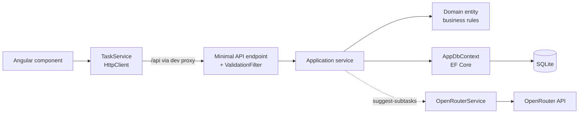

# Smart Tasks

A small full-stack task manager with an AI assistant that breaks tasks down into subtasks.

- Create, edit, filter and delete tasks with a priority and an optional due date
- Track subtasks with a progress bar and check them off
- Ask AI for 3–6 subtask suggestions, pick the ones you want, and save them
- Light and dark themes that follow your OS setting

## Tech stack

| Layer | Technology |
|---|---|
| API | .NET 8 minimal APIs, EF Core 8, SQLite, Swagger (Swashbuckle) |
| Tests | xUnit, SQLite in-memory |
| UI | Angular 22 (standalone components, signals, zoneless), typed reactive forms, SCSS |
| AI | [OpenRouter](https://openrouter.ai) chat completions with a free model |

## Architecture

```
smart-tasks/
├─ api/                               .NET backend
│  ├─ global.json                     pins .NET SDK 8
│  ├─ .config/dotnet-tools.json       local dotnet-ef tool
│  ├─ SmartTasks.Api.sln
│  ├─ SmartTasks.Api/
│  │  ├─ Domain/                      entities and business rules (no framework dependencies)
│  │  ├─ Application/                 use cases, DTOs, abstractions (ITaskService, IAiService, IAppDbContext)
│  │  ├─ Infrastructure/              EF Core DbContext, entity configurations, migrations, OpenRouter client
│  │  ├─ Endpoints/                   minimal API routes, validation filter, global exception handler
│  │  └─ Program.cs                   composition root
│  └─ SmartTasks.Api.Tests/           unit tests (domain, services, AI output parser)
└─ ui/                                Angular frontend
   ├─ proxy.conf.json                 forwards /api to the API during development
   └─ src/app/
      ├─ core/                        models, TaskService (HttpClient), helpers
      ├─ features/tasks/              task-list, task-form, task-detail screens
      └─ shared/                      icon and priority badge components
```

Dependencies point inwards: `Endpoints → Application → Domain`, and `Infrastructure` implements the
abstractions defined in `Application`.

### Request flow



### Design decisions

- **Rich domain model.** Entities have private setters and change only through methods
  (`TaskItem.Update`, `Toggle`, `AddSubTask`, `ToggleSubTask`). `TaskItem` is the aggregate root, so
  subtasks are created and toggled only through it. Shared `Id`, `CreatedAt` and `ModifiedAt` live in an
  `Entity` base class. The DbContext stamps the timestamps on save.
- **Validation in two layers.** DataAnnotations on the request DTOs are checked by an endpoint filter
  and return `400` with field errors. The domain guards the same rules again and throws
  `DomainException`, which is mapped to `400` as well.
- **Consistent errors.** A global `IExceptionHandler` returns RFC 7807 ProblemDetails:
  `400` for domain errors, `502` for AI provider failures, and `500` for anything unexpected (logged,
  never leaked).
- **Typed endpoints.** Handlers return `TypedResults` with `Results<...>` unions, so Swagger documents
  every status code automatically.
- **UTC everywhere.** Timestamps are stored in UTC, and a value converter marks every `DateTime` read
  from SQLite as UTC so the JSON always carries a `Z`.
- **AI output is validated, not trusted.** The model is asked for a JSON array only. The parser
  extracts the array even when it's wrapped in prose or code fences, trims, removes blanks and
  duplicates, enforces the title length and requires 3–6 items. It also drops subtasks that already
  exist. Suggestions are **never saved automatically**: the user picks which ones to add.

## Getting started

### Prerequisites

- [.NET SDK 8](https://dotnet.microsoft.com/download/dotnet/8.0)
- [Node.js 22 LTS](https://nodejs.org) (Angular 22 requires `^22.22.3`)
- An [OpenRouter API key](https://openrouter.ai/keys). This is optional: everything except AI
  suggestions works without it.

### 1. Run the API

```bash
cd api
dotnet tool restore                                   # installs the local dotnet-ef tool
dotnet ef database update --project SmartTasks.Api    # creates SmartTasks.Api/smarttasks.db

# Store the OpenRouter key outside the repo (user secrets)
dotnet user-secrets set "OpenRouter:ApiKey" "<your-key>" --project SmartTasks.Api

dotnet run --project SmartTasks.Api
```

The API listens on `http://localhost:5062`, and Swagger is at `http://localhost:5062/swagger`.
`SmartTasks.Api/SmartTasks.Api.http` contains a sample request for every endpoint.

### 2. Run the UI

```bash
cd ui
npm install
npm start
```

Open `http://localhost:4200`. The dev server proxies `/api` to the API (see `proxy.conf.json`), so
the browser talks to a single origin.

### 3. Run the tests

```bash
cd api && dotnet test     # domain, service and AI parser tests on in-memory SQLite
cd ui && npm test         # Angular unit tests (Vitest)
```

## Configuration

`api/SmartTasks.Api/appsettings.json`:

| Setting | Default | Notes |
|---|---|---|
| `ConnectionStrings:Default` | `Data Source=smarttasks.db` | Relative to the project folder |
| `OpenRouter:BaseUrl` | `https://openrouter.ai/api/v1/` | |
| `OpenRouter:Model` | `nvidia/nemotron-3-super-120b-a12b:free` | Any OpenRouter model id; free models end in `:free` |
| `OpenRouter:TimeoutSeconds` | `30` | 5–120 |
| `OpenRouter:ApiKey` | — | **User secrets only.** Never commit it. |

## API reference

All routes are under `/api/tasks`.

| Method | Route | Description | Responses |
|---|---|---|---|
| `GET` | `/?status=Open\|Done&priority=Low\|Medium\|High` | List tasks (open first, then by priority) | 200 |
| `GET` | `/{id}` | Get a task with its subtasks | 200, 404 |
| `POST` | `/` | Create a task | 201, 400 |
| `PUT` | `/{id}` | Update a task | 200, 400, 404 |
| `DELETE` | `/{id}` | Delete a task and its subtasks | 204, 404 |
| `PATCH` | `/{id}/toggle` | Toggle a task done/open | 200, 404 |
| `POST` | `/{id}/subtasks` | Add a subtask | 201, 400, 404 |
| `PATCH` | `/{id}/subtasks/{subTaskId}/toggle` | Toggle a subtask | 200, 404 |
| `POST` | `/{id}/suggest-subtasks` | Get AI subtask suggestions (not saved) | 200, 404, 502 |

`priority` is sent as a number in JSON (`0` Low, `1` Medium, `2` High). Query strings accept either
the name or the number.

## Troubleshooting

- **Swagger shows "Unable to render this definition".** The Swagger UI bundled with older
  Swashbuckle versions doesn't recognise OpenAPI `3.0.4`, which `Microsoft.OpenApi` 1.6.25+ produces.
  This project uses Swashbuckle `9.0.6`, which does.
- **AI returns "rate limit was reached" (502).** Free models are rate-limited per account and
  sometimes by the upstream provider. The API logs OpenRouter's full error. Wait a moment or switch
  `OpenRouter:Model` to another `:free` model.
- **AI returns "API key is not configured" (502).** Set the user secret shown above, then restart the API.
- **UI shows "Cannot reach the server".** The API isn't running on port `5062`, or the port in
  `ui/proxy.conf.json` doesn't match.
